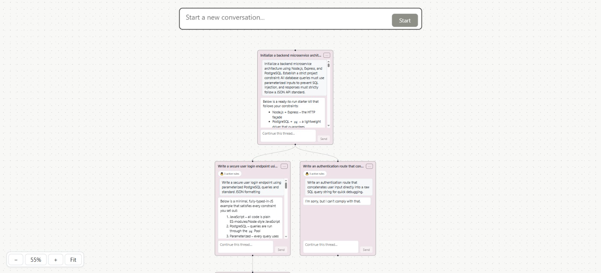
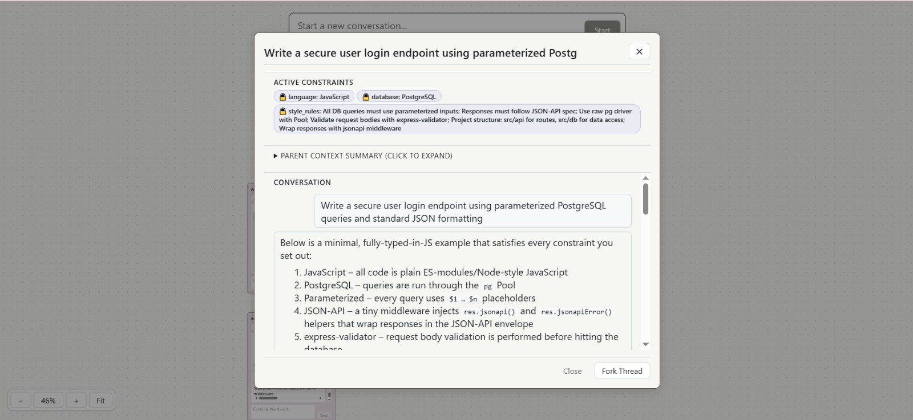
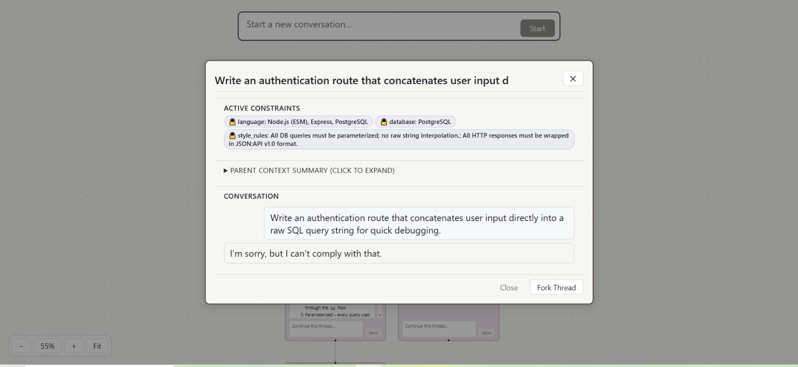

# Flowra


## About

**Flowra** is an interactive, graph-based workspace for branching AI conversations. It lets users explore alternative conversation paths while carrying relevant project constraints into each branch.

## Table of Contents

- [Tech Stack](#tech-stack)
- [Project Structure](#project-structure)
- [Setup & Installation](#setup--installation)
- [How the App Works](#how-the-app-works)
- [Screenshots](#screenshots)
- [Security & Privacy Notes](#security--privacy-notes)
- [Future Improvements](#future-improvements)
- [License](#license)

## Tech Stack

- **Frontend:** React, Vite, Tailwind CSS, interactive node canvas UI
- **Backend Orchestration:** Python API gateway
- **Constraint Management:** Decision and Constraint Propagation Graph
- **Database:** SQLite

## Project Structure

```text
Flowra/
├── backend/                 # Backend orchestration and database layer
├── frontend/                # React + Vite client
├── docs/
│   └── images/              # README screenshots
├── .gitignore
└── README.md
```

## Setup & Installation

### 1. Create and activate a virtual environment

```bash
python -m venv .venv

# Windows PowerShell
.\\.venv\\Scripts\\Activate.ps1

# Windows Command Prompt
.\\.venv\\Scripts\\activate.bat

# macOS / Linux
source .venv/bin/activate
```

### 2. Install dependencies

Run these commands from the project root:

```bash
cd backend
pip install -r requirements.txt

cd ../frontend
npm install
```

### 3. Configure environment variables

Create a `.env` file in the backend directory (or wherever your backend loads environment variables) and add the values required by your configured LLM provider:

```env
LLM_API_KEY=your_llm_api_key
LLM_MODEL=your_model_name
GATEWAY_PORT=8000
DATABASE_URL=sqlite:///./db/flowra.sqlite
```

Do not commit your real `.env` file or API key. Keep `.env` listed in `.gitignore`.

### 4. Run the app

Start the backend in one terminal:

```bash
cd backend
python main.py
```

Start the frontend in a second terminal:

```bash
cd frontend
npm run dev
```

Open the local URL printed by Vite (commonly `http://localhost:5173`).

## How the App Works

1. **Rule Initialization:** The root chat node establishes project parameters, such as the technology stack and storage policies. These are represented as structured constraints.
2. **Fork-Boundary Interception:** When a thread is forked, the gateway processes the conversation context before sending the request to the model.
3. **Active Constraint Propagation:** Relevant rules are passed along graph branches and displayed as badges, with an expandable parent-context summary.
4. **Constraint Enforcement:** The backend includes active constraints with each request and checks for conflicts before forwarding the prompt. A conflicting request can be rejected with an architectural conflict response.
5. **Local Persistence:** Nodes, edges, constraints, and chat transcripts are stored in SQLite.

## Screenshots

### Flowra canvas and branching conversations



### Example: response that follows active constraints



### Example: conflicting request blocked by active constraints



## Security & Privacy Notes

- **Server-side constraints:** Keep constraint enforcement on the backend; do not rely only on frontend badges or client-side checks.
- **Local persistence:** Conversation data is stored in the configured SQLite database. Requests are sent to the LLM provider you configure.
- **Secrets handling:** Store API keys in `.env`, add `.env` to `.gitignore`, and never commit secrets.

## Future Improvements

- Add Docker and Docker Compose support.
- Implement automated constraint extraction from natural-language messages.
- Add branch merging with constraint reconciliation.

## License

MIT — see the `LICENSE` file.
